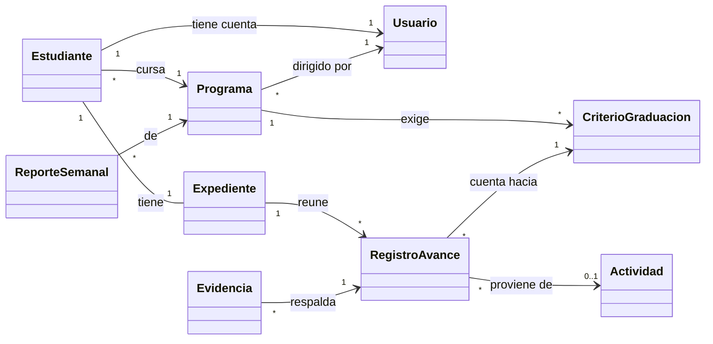
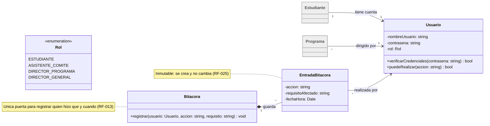
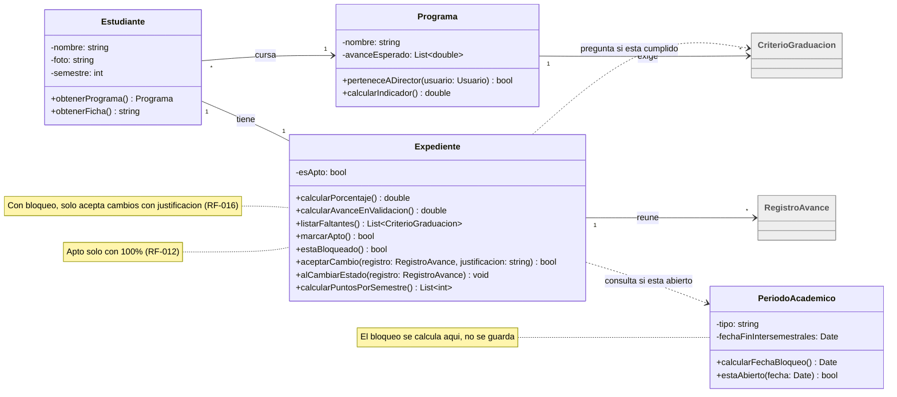
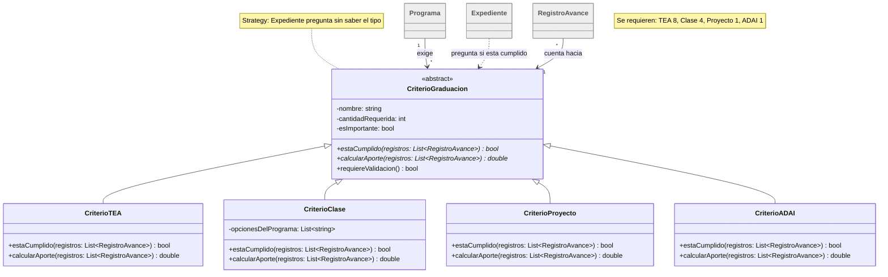
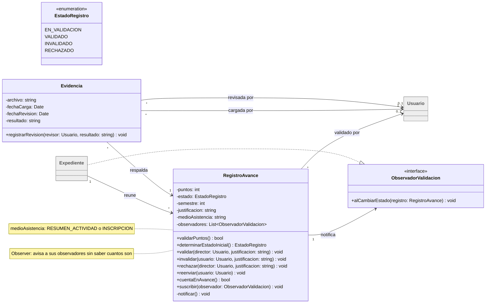
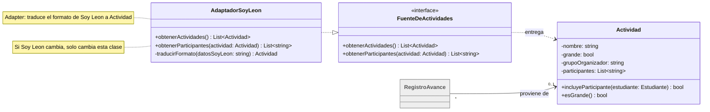
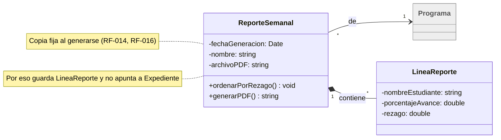

DIAGRAMA DE CLASES POR PARTES (7 laminas)
 
##### PARTE 1 de 7 · MAPA GENERAL (solo nombres) #####

 
##### PARTE 2 de 7 · ACCESO Y BITACORA #####
 

 
##### PARTE 3 de 7 · EXPEDIENTE Y AVANCE #####
 

 
##### PARTE 4 de 7 · CRITERIOS DE GRADUACION (patron Strategy) #####
 

 
##### PARTE 5 de 7 · VALIDACION DE AVANCE (patron Observer) #####
 

 
##### PARTE 6 de 7 · INTEGRACION CON SOY LEON (patron Adapter) #####
 

 
##### PARTE 7 de 7 · REPORTES SEMANALES #####
 

