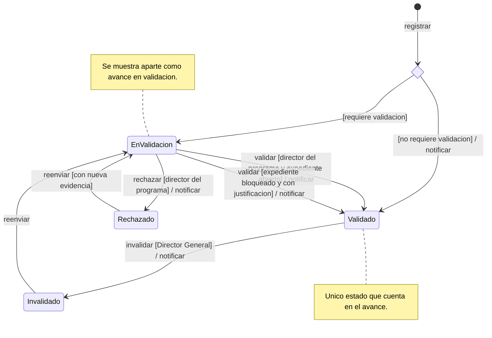
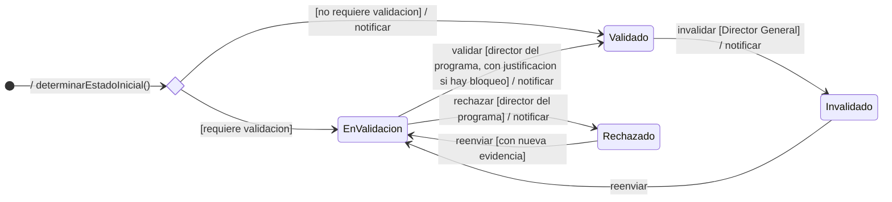

## Diagrama de máquina de estados: RegistroAvance

## Diagrama de máquina de estados: RegistroAvance
 

 
No hay estado final: un registro de avance no termina, permanece en el expediente del estudiante. Solo el estado Validado cuenta en el avance; En validación se muestra aparte.
