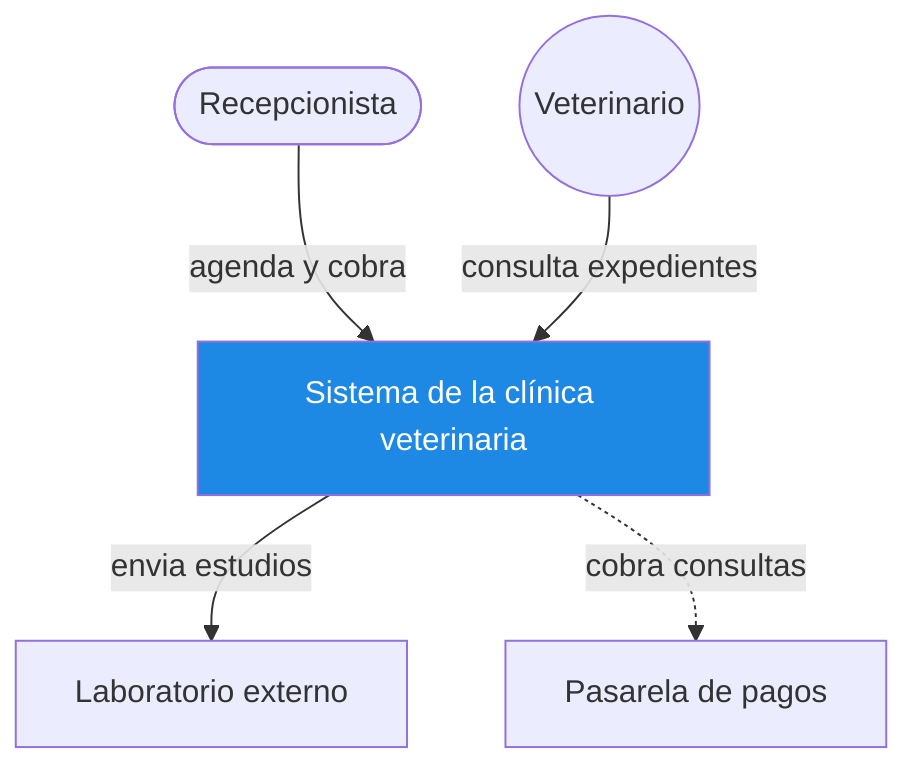
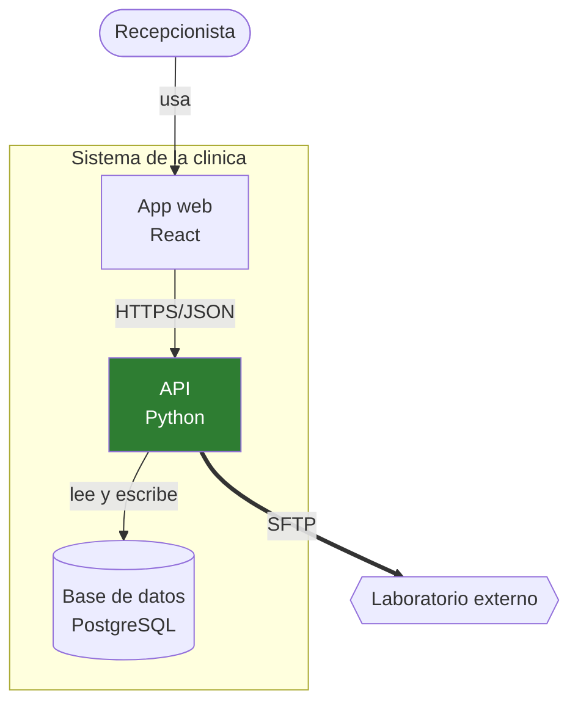
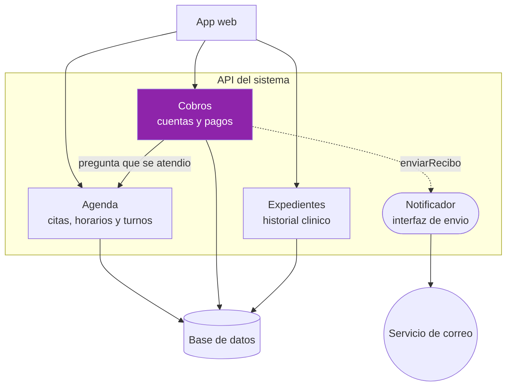
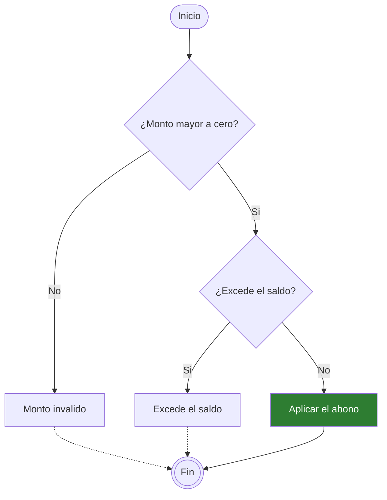
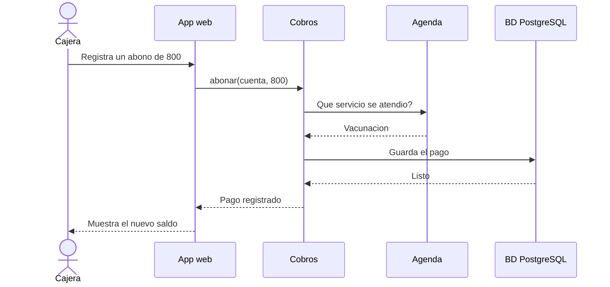
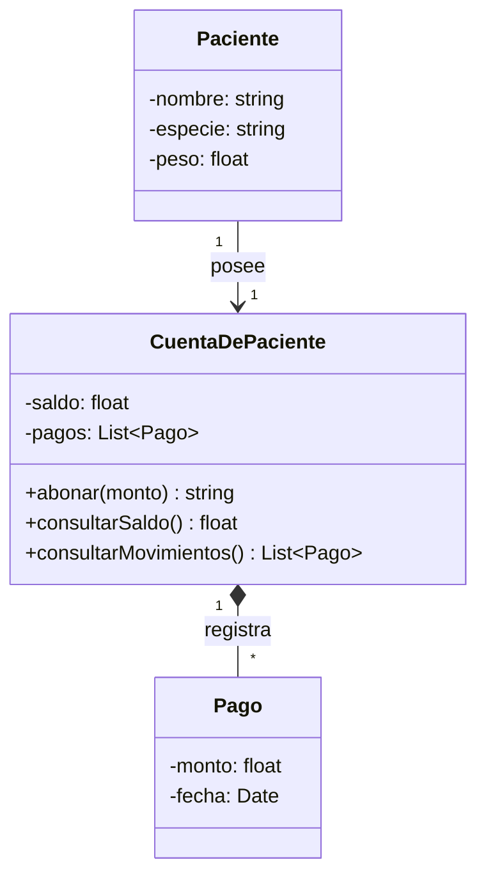
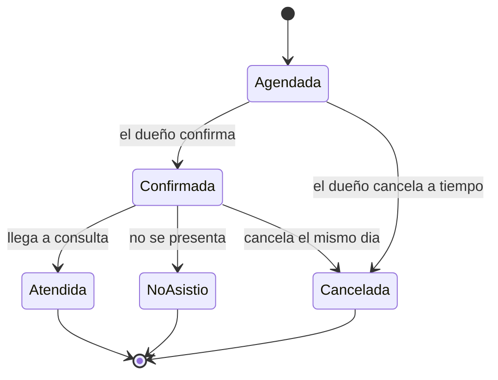
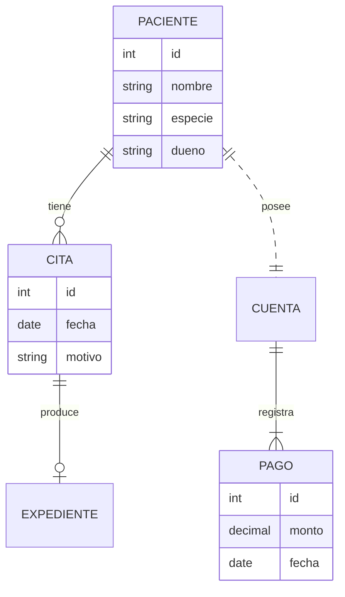

# Diagramas de Mermaid

## Diagrama de contexto

## Diagrama de contenedores

## Diagrama de componentes

## Diagrama de flujo con decisiones

## Diagrama de secuencia

## Diagrama de clases

## Diagrama de estados

## Diagrama entidad-relacion

